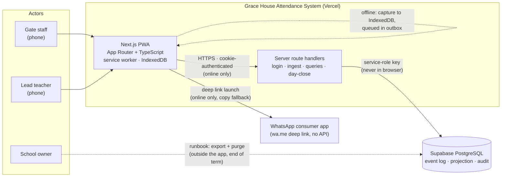
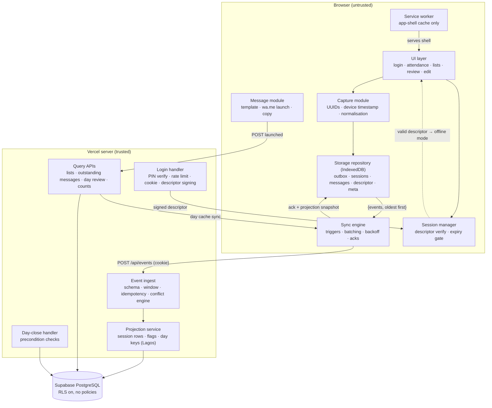
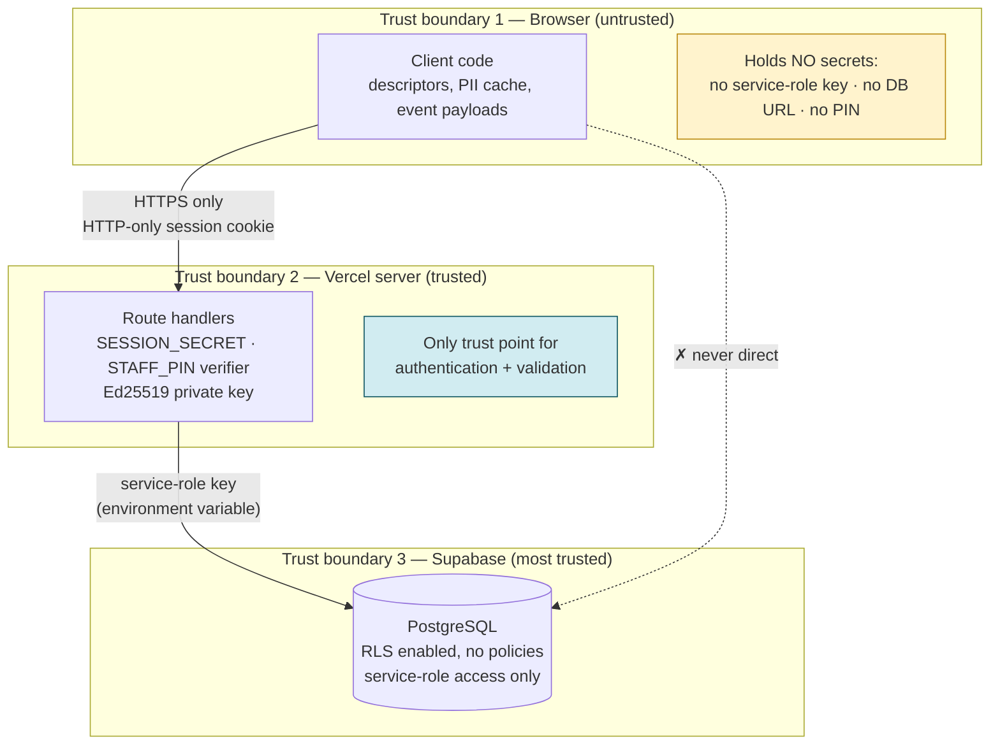
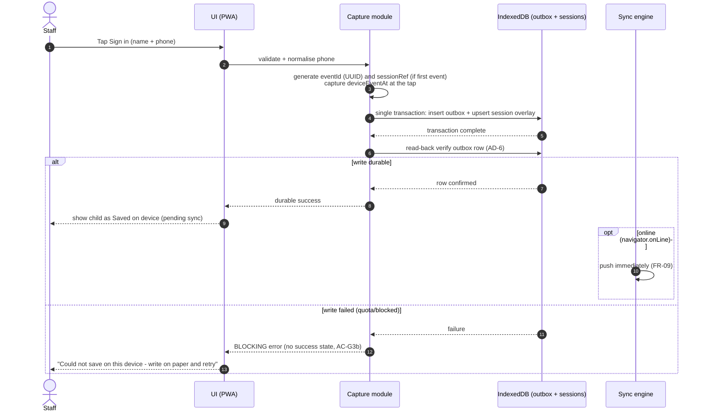
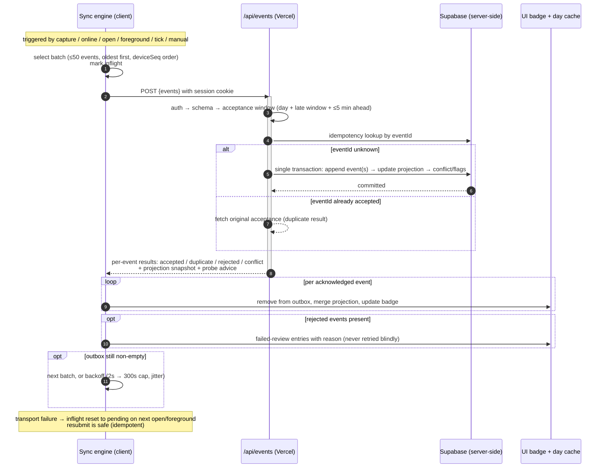
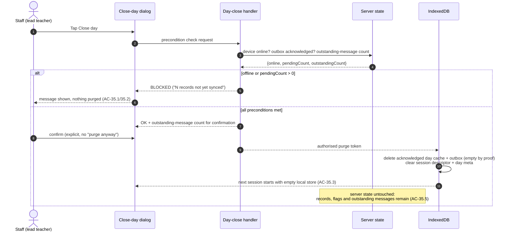

# System Architecture Document
# Grace House School Attendance Sign-In (Offline-First PWA)

| | |
|---|---|
| **Document** | System Architecture v1.0 |
| **Date** | 30 October 2026 |
| **Author** | Lead Software Architect |
| **Status** | Draft for technical review — architecture decisions AD-1…AD-10 recorded; stakeholder-gated items (Q13–Q16, Q5) flagged, not decided |
| **Product source of truth** | `PRD_v1.2.md` (all requirement IDs below — FR-, BR-, S-, AC-, E-, RK-, SC- — refer to it) |
| **Supporting technical references** | `PRD_VERIFICATION_REPORT.md` (verdict: APPROVED WITH CONDITIONS), `PRD_AUDIT_v1.1.md`, `PRD_CHANGELOG_v1.2.md` |
| **Scope limits** | This document specifies the system at design level: components, data model (logical fields only), protocols, trust boundaries and decisions. **No application code, no SQL, no migrations are written here** — those belong to the implementation phase (`IMPLEMENTATION_PLAN_v1.0.md`). |
| **Honesty rules applied** | No pending stakeholder decision is treated as approved (Q13–Q16, Q5 remain open). No paid services or paid WhatsApp APIs. No production release is promised by 31 October 2026. Uncertainties are stated with a recommended test (§11.3). |

---

## 1. Architecture overview

### 1.1 System at a glance

A single Next.js (App Router, TypeScript) application deployed to Vercel, backed by Supabase PostgreSQL, installed on staff phones as a Progressive Web App. The browser holds the authoritative local copy of the day's data while offline; the server holds the authoritative record of everything that has been acknowledged. WhatsApp is reached by deep link only. All times are displayed in Africa/Lagos.

Diagrams: system context, component and trust-boundary diagrams are in **§10** (Figures 10.1–10.3).

### 1.2 Components, responsibilities and boundaries

| Component | Technology | Responsibility | Boundary — what it must never do |
|---|---|---|---|
| **Web application (client)** | Next.js App Router client components, TypeScript | UI (login, attendance, lists, review), input validation, phone normalisation, capture workflow, local rendering from IndexedDB, message composition, WhatsApp launch, sync orchestration | Never holds the service-role key or any database credential; never talks to Supabase directly; never claims a state it cannot verify (BR-22, U-A10) |
| **Server API** | Next.js route handlers (server-only) in the same deployable | PIN verification, session cookie issuance, Ed25519 descriptor signing, event ingestion (validation → idempotency → projection), queries, launch-marker writes, day-close validation | Never sends WhatsApp messages; never accepts a descriptor in place of a cookie; never returns service-role credentials to the client |
| **Database** | Supabase PostgreSQL | Append-only event log, session projection, audit stores (corrections, conflicts, login attempts) | Never reachable from the browser: RLS enabled with **no policies**; only server code uses the service-role key (S2, S3) |
| **Deployment** | Vercel | HTTPS termination, environment variables (`SUPABASE_URL`, `SUPABASE_SERVICE_ROLE_KEY`, `SESSION_SECRET`, `STAFF_PIN`/verifier, `SCHOOL_NAME`), serverless execution near the Supabase region | Secrets stay in server environment variables only |
| **Service worker** | Browser SW, registered by the app | Cache the **application shell** (HTML/JS/CSS/manifest/icons), serve navigation offline, apply versioned updates | **Not a data layer**: it never caches API responses as a source of truth, and Background Sync is never relied upon (A6/C9 — iOS support is not guaranteed). All attendance data lives in IndexedDB |
| **Local persistence** | IndexedDB | Outbox, day cache, message-state cache, signed session descriptor, device metadata | Holds unencrypted PII for the current day only; purged at gated day close (FR-35); never holds PIN material (S11) |
| **WhatsApp hand-off** | `wa.me` deep link from the browser | Opens WhatsApp with pre-filled text; Copy fallback | No WhatsApp Business API, no accounts, no cost (C2, N1); browser verification stops at "navigation initiated" (C11) |
| **Time handling** | `Intl.DateTimeFormat` (client), `timestamptz` instants (server) | Store instants; render in `Africa/Lagos` (UTC+1, no DST), 12-hour, with date (FR-22); compute day keys in Lagos (§16.4) | Never store or render attendance times in the device's local zone as the display truth |

### 1.3 Why one deployable

One developer, one codebase, one deployment: client and server share types and validation rules, the server is the only trust boundary that changes, and there is no separate API service to operate (free-tier friendly, C2). The service worker is deliberately thin so the app's behaviour is testable in a normal browser.

### 1.4 Online vs offline operation

| Operation | Online path | Offline path |
|---|---|---|
| Login | Server verifies PIN → cookie + signed descriptor | **Not possible** — "connect to log in" (FR-04) |
| Open app with valid descriptor | Cookie for API calls; descriptor verified locally too | Descriptor verified locally; app opens fully (FR-04) |
| Sign-in / sign-out | Write-ahead local capture, then immediate push | Write-ahead local capture, queued in outbox (FR-08/09) |
| Lists, counter, search | Rendered from local day cache overlaid with server state | Same — local only (FR-17/19/21) |
| WhatsApp launch | Launch permitted; marker written server-side (FR-27) | **Not permitted by the application**; Copy control still works (FR-26, N3) |
| Corrections | Audited correction path (FR-30) | **Online-only for the pilot** (AD-5, pending Q13) |
| Day review | Full view after sync; device-scoped offline with banner (FR-31) | Same, banner shown |
| Day close | Gated online operation (FR-35) | **Blocked** (AC-35.1) |
| Sync | Automatic on capture/reconnect/foreground | Idle — outbox waits (FR-10) |

---

## 2. Offline-first architecture

### 2.1 Application shell caching

- The service worker precaches the versioned app shell on install (routes, JS/CSS bundles, fonts, manifest, icons) and serves static assets cache-first.
- Navigation requests are served from the cached shell (stale-while-revalidate), so the app **opens with no network at all** (P7).
- A versioned cache name means an app update installs in the background and activates on the next reload; an update is never forced mid-session.
- `/api/*` responses are **never** cached by the service worker. Server data enters the device only through the sync protocol into IndexedDB (§2.3), which keeps exactly one local data path.
- Background Sync is **not** used as a mechanism (A6/C9): sync triggers are explicit application events (§2.9).

### 2.2 Local data model — responsibilities

IndexedDB is the local system of record until the server acknowledges. Responsibilities:

1. **Durability first:** every attendance action is committed locally before any UI success state exists (FR-08, BR-21).
2. **Queue of record:** the outbox holds every unacknowledged event; nothing else decides what still needs to be sent (FR-13).
3. **Offline read model:** the day cache renders lists/counter/review without network (FR-17/19/31).
4. **Session continuity:** the signed descriptor opens the app offline (FR-04); no PIN material ever enters it (S11).
5. **Metadata:** device identifier, rate-limit counter, clock-probe results, last sync time, schema version (AD-8, FR-12, FR-03).

### 2.3 IndexedDB stores (conceptual) and relationships

| Store | Key fields (logical — no SQL) | Notes |
|---|---|---|
| **`outbox`** | `eventId` (PK, client UUID), `sessionRef`, `eventType`, payload, `deviceEventAt`, `deviceId`, `deviceSeq`, `capturedOffline`, `state`, `attempts`, `nextAttemptAt`, `lastError`, `createdAt` | `state ∈ {pending, inflight, failed-retryable, failed-review, acked}`. Acked entries are removed only after the acknowledgement is applied to the day cache. **Never purged unacknowledged** (FR-35, BR-17) |
| **`sessions`** (day cache) | `sessionRef` (PK), `dayKey`, `studentName`, `parentPhone`, displayed `signedInAt` / `signedOutAt`, `signedInBy` / `signedOutBy`, `correctedFlag`, `conflictFlag` (+type), `lateSyncedFlag`, `whatsappLaunchedAt`, `serverVersion`, `syncState` | Mirror of the server projection for today, overlaid with this device's not-yet-acknowledged events so lists are correct while offline |
| **`messages`** (logical view) | `sessionRef`, launch state | Cache of the server-held outstanding-message list (AD-9); server copy survives purge and day close (FR-26 AC-26.4) |
| **`sessionDescriptor`** | single record: `staffName`, `issuedAt`, `expiresAt`, `keyId`, signature | Nothing else — no PIN, no verifier (FR-04, AC-04.3) |
| **`meta`** | `deviceId`, login attempt counter + lock-until, last probe (`offsetSec`, `rttMs`, `measuredAt`), `lastSyncAt`, `schemaVersion`, current `dayKey` | Cleared at day close except `deviceId` |

Relationships: `outbox.sessionRef → sessions.sessionRef`; `messages.sessionRef → sessions.sessionRef`. `sessions` rows are **derived state** — rebuilt from the server projection on every sync; `outbox` rows are **facts** — authoritative until acknowledged. On conflict between the two (server says X, local pending event implies Y), the local pending event **overlays** the server row for display until acknowledged (FR-17.1 requires unsynced children to appear).

### 2.4 Write-ahead capture workflow

For every action (online or offline — one path only, FR-09/AC-09.3):

1. Validate input client-side (FR-05, FR-06 normalisation).
2. Generate identities **before persistence**: `eventId = UUID` (BR-20); if this is the first event of a child-session, also generate `sessionRef = UUID` (§16.4 of PRD v1.2 — offline-capable session reference, no server round-trip possible).
3. Capture the device timestamp once, at the tap (FR-07); attach `deviceId`, next `deviceSeq`, `capturedOffline = !navigator.onLine`, staff name from the active session (BR-01).
4. Open one IndexedDB transaction: insert into `outbox`, upsert the overlay row in `sessions`.
5. Wait for transaction completion **and read the outbox row back** (AD-6) to confirm durability.
6. **Only now** render the success/pending UI (FR-08, BR-21). If the write failed (quota, blocked storage): show the blocking error with the paper instruction — no success state, no child in the list, no outbox entry (AC-G3b).
7. If online, kick the sync engine immediately (FR-09); the UI state machine is identical offline (Pending → Synced).

### 2.5 Durable-write confirmation before UI success

- The success state is derived from the read-back confirmation of step 5, not from the button handler (SC6).
- Storage failure is a **blocking state**, not a toast (§11.8 of PRD v1.2; E16).
- Low-storage warnings appear before failure: `navigator.storage.estimate()` checked at app open and after each capture batch; warn when free space drops below the larger of 10% or 5 MB *(proposed threshold — measurable, adjust during pilot test §11.3)*.

### 2.6 Persistent storage request and quota handling

- On first successful login, request **persistent storage** (`navigator.storage.persist()`); record the granted state in `meta` (FR-08, A13).
- Persistent storage reduces eviction risk but does **not** prevent deliberate clearing or hardware loss (E21 — residual risk pending Q16). The UI never implies otherwise (BR-22).
- Quota exhaustion path: warning → (if a write then fails) blocking error (AC-G3b) → staff uses paper → after sync + day close the purge frees the store for the next session (FR-35).

### 2.7 Offline outbox

State machine per event:

```
pending ──► inflight ──► acked (removed after applying ack)
   ▲            │
   │            ├─ transport failure / 5xx ──► failed-retryable ──► pending (backoff)
   │            ├─ validation rejection ─────► failed-review (needs review, never retried blindly)
   │            └─ conflict with existing ───► acked + conflict recorded on the session
   └── app restart resets stale inflight entries to pending
```

- `failed-review` is terminal until a human acts (FR-15: rejected events stay visible with a reason and block day close).
- The sync badge reflects counts across these states (FR-10).

### 2.8 Retry and backoff strategy

| Situation | Behaviour |
|---|---|
| Capture while online | Push immediately (part of the action flow, FR-09) |
| Retry after transport failure | Exponential backoff with jitter: **2 s, 5 s, 15 s, 60 s, 300 s (cap)** ±20% jitter; then every 5 minutes while the app is open and online |
| Server returns 429 | Honour `Retry-After` if present, else use the next backoff step |
| Server returns 4xx validation (`failed-review`) | No automatic retry; surfaced with reason (E15) |
| Manual | "Retry" on the badge and per-row (FR-10.2) — manual retry resets the backoff timer and never duplicates (idempotency, FR-13) |
| Offline | No retries attempted; `online` event and foreground triggers start the loop (§2.9) |

Retries never stop permanently for retryable failures: an event remains pending until acknowledged or rejected to review — it is never dropped (E2, FR-13).

### 2.9 Reconnection and foreground sync triggers

The sync engine runs when any of these fires (AD-2):

1. Immediately after a capture (online case).
2. `window` `online` event (connectivity returned).
3. App start (page load / PWA open).
4. Foreground return (`visibilitychange` → visible) — **mandatory** because iOS does not guarantee background sync (A6/C9, RK13).
5. A periodic tick while the tab is visible *and* the outbox is non-empty (every 60 s).
6. Manual Retry.

Only one sync loop runs at a time (in-flight guard); a trigger during an active run is coalesced.

### 2.10 Server acknowledgements

- An acknowledgement for an event exists only after the server transaction that accepts it has **committed**.
- The client applies the ack by: removing the outbox entry → merging the authoritative projection row into `sessions` → updating badge counts.
- Acknowledgements are per-event, even when transport is per-batch (§5).
- The clock probe result (AD-3) may be piggybacked on sync responses; it is advisory data, never a gate.

### 2.11 Duplicate prevention and idempotency

Three layers:

1. **Identity:** `eventId` generated once at capture, immutable afterwards (BR-20); retries resend the same identity.
2. **Server acceptance:** each `eventId` accepted exactly once; a repeat submission returns the **original acknowledgement** — not an error, not a second row (FR-13, AC-13.2).
3. **Client hygiene:** an event is removed from the outbox only after ack; interrupted in-flight entries reset to `pending` and are resubmitted, safe by layers 1–2 (AC-13.3).

Per-device `deviceSeq` (monotonic) plus the rule that a session's sign-in event is enqueued before any sign-out for that session on that device prevents a device's own events from arriving out of order (FR-13 "Ordering").

### 2.12 Failed-event recovery

| Class | Trigger | Recovery |
|---|---|---|
| `failed-retryable` | Network, 5xx, timeouts | Automatic backoff retry; manual Retry (FR-10) |
| `failed-review` | Outside acceptance window (FR-15), schema rejection | Visible with reason on the row and badge; resolved through the authorised correction/re-entry path with audit; **never disappears from the failed list** (AC-15.4); blocks day close |
| `conflict` | Second competing event accepted by server | Event is acknowledged; session carries a conflict flag; lead teacher resolves via audited correction (FR-16/FR-30) |

Day close (FR-35) is refused while any outbox entry is not `acked`, which makes failed-event recovery structurally mandatory before purge (AC-35.4).

### 2.13 Browser refresh, closure and device restart

- Nothing authoritative lives in memory or per-tab state: after refresh, the app rehydrates `sessions`, `outbox`, descriptor and `meta` from IndexedDB and resumes (FR-14, AC-14.1).
- Closing the browser or the installed PWA loses nothing — IndexedDB persists (AC-14.2).
- Device restart → reopen → service worker serves the shell offline → rehydrate → sync triggers fire (AC-14.3).
- **Out of scope and documented, not hidden:** deliberate browser-data clearing, eviction under storage pressure, and hardware loss can destroy unsynchronised events (E21, RK15 — residual risk **pending Q16**). Mitigations: persistent-storage request, aggressive sync-when-online, low-storage warning, and the end-of-day "All synced" check.

---

## 3. Attendance event architecture

The PRD's three-part model (PRD v1.2 §16.1): **(1) append-only event log, (2) session projection, (3) audit and conflict records.** Logical fields only — no SQL in this document.

### 3.1 Part 1 — Append-only event log

One row per captured action. Fields:

| Field | Purpose | Immutability |
|---|---|---|
| `eventId` (PK) | Client-generated UUID at capture, before persistence — idempotency key (FR-13, BR-20) | Immutable, never regenerated |
| `eventType` | `sign_in` \| `sign_out` \| `correction` | Immutable |
| `sessionRef` | Links the event to one child-session (client-generated UUID at first sign-in — §3.4) | Immutable |
| Payload | Submitted identity (`studentName`, `parentPhone`) carried on the sign-in event so the projection can be rebuilt from the log | Immutable |
| `deviceEventAt` | **Time of record** for this event, captured at the tap (FR-07) | **Immutable** (BR-05) |
| `serverReceivedAt` | Server receipt, set at ingestion | **Immutable** (BR-05) |
| `capturedOffline` | Offline-origin flag (FR-12) | Immutable |
| `deviceId` + `deviceSeq` | Device attribution; ordering/regression checks (FR-12/13) | Immutable |
| `staffName` | Attribution from the active session (BR-01 — *who said they did it*, D6) | Immutable |
| `dayKey` | Lagos calendar date of `deviceEventAt` (§16.4) | Immutable |
| `conflictMarker` | `none` \| `losing` \| `rejected` — evidence marking (FR-16) | Set at ingest, never removed |
| `queuedDuration` | Derived at ingest: `serverReceivedAt − deviceEventAt`, **labelled queue time, never skew** (FR-12b, AC-12.3) | Derived once, stored as evidence |

**No application path updates or deletes an event.** Corrections never touch the log (AC-11.4: "stored events remain byte-identical").

### 3.2 Part 2 — Session projection

One row per child-session; the only mutable, UI-facing state.

| Field | Purpose |
|---|---|
| `sessionRef` (PK) | Client-generated reference (§3.4) |
| Identity | Current `studentName` / `parentPhone` (editable via FR-29 with audit) |
| Displayed `signedInAt` / `signedOutAt` | Derived from **accepted** events; displayed; changeable only via audited correction (FR-30) |
| `dayKey` | Lagos date of the sign-in event; scoping key for lists, review, CSV (§16.4) |
| `signedInBy` / `signedOutBy` | Attribution |
| `serverVersion` | Monotonic counter; incremented on every accepted change — the base for correction version checks (§3.8) |
| `syncState` | synced / pending / failed / needs-review |
| Flags | `corrected`, `conflict` (+type), `lateSynced` |
| `whatsappLaunchedAt` | Server-held launch marker (renamed from `message_opened_at`, T-L2) |

### 3.3 Part 3 — Audit and conflict records

- **Corrections:** `correctionId`, `sessionRef`, field, original displayed value, new value, **base value + base `serverVersion` it was based on**, `editedBy`, `editedAt`, linked conflict (if any) (FR-30, S13).
- **Conflicts:** `conflictId`, `sessionRef`, conflict type, winning `eventId`, losing `eventId(s)`, winner's `serverReceivedAt`, resolution (chosen value), `resolvedBy`, `resolvedAt` (FR-16, AC-16.3).
- **Login attempts:** rate-limit identifier, timestamp, outcome (FR-03).

### 3.4 Sign-in and sign-out as separate events

A child-session is built from independently captured events: one `sign_in`, optionally one `sign_out` (BR-06 — exactly one *accepted* sign-out; later competing sign-outs become flagged conflicts, never overwrites). Each event carries its own dual timestamps and its own idempotency key, so a retried sign-out deduplicates correctly and a sign-in/sign-out captured on different devices both remain attributable (T-C1).

**Session references, offline-capable:** the reference is generated **on the client at the moment of the first sign-in capture, before persistence** — a server-assigned reference is impossible offline (no round-trip). The server accepts and binds the client reference to the accepted sign-in event and never renumbers it. **A second sign-in after an accepted sign-out starts a new session** with a new `sessionRef` (PRD v1.2 FR-16 new-session rule); it is not a conflict.

### 3.5 Device identifiers and sequences

- `deviceId`: random UUID created once per browser install, stored in `meta` (AD-8) — used for skew attribution, ordering checks and as the rate-limit key (with FR-03's documented reset-on-clear limitation). It is **not** a security credential.
- `deviceSeq`: monotonically increasing integer incremented per capture on that device; a decreasing sequence for the same device is a consistency flag (FR-12c) and can never occur within one device by construction.

### 3.6 Timestamps

- `deviceEventAt` — time of record, taken from the device clock at the tap; never typed (FR-07); immutable.
- `serverReceivedAt` — set by the server at ingestion; establishes provenance; immutable.
- Their difference is **queue duration**, stored and labelled as such; it is never presented as clock skew (FR-12b, AC-12.3, BR-22).
- Current clock offset is estimated only by an online round-trip probe (±½ RTT, AD-3) at app open, foreground and sync start. **True offline wall-clock accuracy cannot be verified** (FR-12 verifiability statement).

### 3.7 First-synchronised-wins and conflicting-event preservation

When two events compete for the same slot on the same session (e.g. two devices sign the same child out offline):

1. The server orders competing events by `serverReceivedAt` — **the first synchronised event wins** the displayed time (FR-16).
2. The losing event is **retained permanently** in the log with `conflictMarker = losing`; a conflict record links both event IDs; the session gets `conflictFlag` + type (FR-16, FR-32).
3. The UI shows the flag (icon + text, never colour alone) in the list and day review.
4. Resolution is the lead teacher choosing a value via the **audited correction**, which references the conflict; both originals remain retrievable afterwards (AC-16.3).

Nothing is ever silently overwritten or discarded: the log is append-only, conflicts are records rather than deletions, and rejection states retain the event on the device (AC-16.2, BR-12).

### 3.8 Correction version checks

Each correction carries the displayed value and `serverVersion` it was based on (FR-30 conflict-safe design):

- At ingestion, if the submitted base `serverVersion` equals the projection's current version → apply: update displayed times, write the correction audit row, set `correctedFlag`, bump `serverVersion`.
- If not equal (the record changed on another device meanwhile) → **do not apply**: both values are retained, the session is flagged `correction-conflict` for review (AC-30.5).
- Offline-captured corrections: supported by the model (event type `correction` + queued payload) but **not built for the pilot** — AD-5 is gated on Q13 (default: online-only corrections).

### 3.9 Late-sync handling

- At ingestion, an event whose `dayKey` is in the past is accepted if within the **permitted late-sync window — proposed 7 days, pending confirmation in Q5** (PRD v1.2 FR-15/BR-11/S12): it attaches to its original day, is flagged `lateSynced`, and appears in that day's review (E23, AC-15.5).
- Beyond the window (or more than 5 minutes future-dated): rejected to the device's visible `failed-review` state with a reason — never silently dropped (AC-15.2/15.4).
- Late events never re-date a session: `dayKey` derives from `deviceEventAt`, never from sync time (§16.4).

### 3.10 Lagos calendar-day projection

All read models (in-school list, signed-out list, counter, day review, outstanding messages, CSV) scope by `dayKey` computed as the **Africa/Lagos** calendar date of `deviceEvent_at`. Display formatting uses `Intl.DateTimeFormat('…', { timeZone: 'Africa/Lagos' })` so every phone shows identical times regardless of device settings (FR-22). Lagos is UTC+1 with no DST, so day boundaries are stable.

---

## 4. Authentication and trust boundaries

Trust boundaries are drawn in **§10, Figure 10.3**. Rule of thumb: **the browser is untrusted, the server is trusted, the database is most trusted.**

### 4.1 Shared PIN login (online only)

1. Client sends `{ staffName, pin, deviceId }` to `POST /api/login` over HTTPS.
2. Server checks the rate limit (§4.6), then verifies the PIN against a **server-held verifier** (environment configuration) with constant-time comparison. The PIN and its verifier never leave the server and are never logged (FR-01, S5).
3. On success the server: creates a signed **HTTP-only session cookie** (§4.2) and signs a **session descriptor** (§4.3), returned in the response body for local storage.
4. On failure: generic error; five failures per identifier → 5-minute lockout with visible remaining wait (FR-03).

### 4.2 Online layer — HTTP-only session cookie

- Signed token (HMAC with `SESSION_SECRET`) containing staff name + issued/expiry; **12-hour expiry** (FR-02).
- Flags: `HttpOnly`, `Secure`, `SameSite=Lax`, `Path=/`.
- **Required on every server API call.** A request without a valid cookie is rejected regardless of anything the client stores (AC-04.4, S11).

### 4.3 Offline layer — signed local session descriptor

- Contents: `staffName`, `issuedAt`, `expiresAt`, `keyId`, nonce — **nothing else; no PIN, no PIN verifier, no shared secret** (FR-04, AC-04.3).
- Signed with the server's **Ed25519** private key at login (AD-1); verified in the browser with the corresponding public key using WebCrypto.
- Checked at app open and on foreground: valid → app operates fully offline; expired → dedicated "Session expired — connect to log in" screen that renders **no attendance data** (AC-04.2, E13).
- The descriptor unlocks only the **local UI**. It is not accepted by any server API — those require the cookie (AC-04.4). A forged or copied descriptor therefore cannot read or write server data.

### 4.4 Public-key distribution and rotation

- The Ed25519 public key(s) + `keyId` ship as static application configuration inside the cached app shell — a public key is not a secret and needs no secure channel.
- Rotation: generate a new key pair, sign new descriptors with the new key, ship the app update carrying both keys; descriptors signed with a retired key verify for at most their remaining 12-hour life. Rotation requires an app release — accepted consequence of AD-1.
- **Uncertainty + test (§11.3):** Ed25519 in WebCrypto is not available on every older Android browser build. Test descriptor verification on **both pilot phones in the first auth task**; fallback algorithm **ES256 (ECDSA P-256)**, which is universally supported, with the same descriptor format.

### 4.5 Descriptor expiry, device clock and its limits

- Expiry is evaluated against the **device clock**, which is untrusted: a rolled-back clock extends offline access until the next online contact (C12, RK16).
- This is **bounded** by server acceptance windows at sync (FR-15) and never lets an attacker touch server data (no cookie). It is a documented limitation, **pending Q16 acknowledgement** — not an accepted trade-off (S14).
- **Copied-descriptor risk (S11):** the descriptor is not device-bound; a copy unlocks the offline UI on another device (carrying no data beyond whatever local day cache exists there). Mitigations: 12-hour expiry, day-close purge, screen lock; residual exposure **pending Q16**.

### 4.6 Rate limiting

- Key: the per-browser random identifier in `meta` (AD-8), sent with each login attempt.
- Client counts failures and shows the wait; **the server independently counts the same identifier** so clearing one side alone does not reset the limit.
- Policy: 5 wrong attempts → 5-minute lockout (FR-03, BR-03), online only.
- Known limitation (documented in FR-03): clearing browser storage resets the identifier; IP-based counting is deliberately **not** used (unreliable on mobile networks).

### 4.7 Server API validation and database access

- Every server route: valid cookie → else 401. Data access uses the **service-role key from Vercel environment variables only** (S2).
- Supabase **RLS enabled on all tables with no policies**: even the public/anon key reads and writes nothing; the browser holds **no database keys at all** (S3).
- Event ingestion additionally enforces: session validity, payload schema, acceptance window, idempotency (§5).
- No secrets, service-role key, or database URL appear in page source, client bundles, or network responses (AC-G1).

### 4.8 Staff attribution and device handover

- Every event and correction stamps `staffName` from the **active session**, i.e. *who said they did it* — shared-PIN attribution is a documented process control, not cryptographic identity (BR-01, S7, D6).
- Handover rule (runbook §14.7): the new staff member **re-logs in** so offline actions attribute to the correct name; on a shared device the last login's name governs until then (§8 of PRD v1.2).

### 4.9 Which operations are allowed offline vs server-validated

| Offline allowed (local enforcement) | Requires server validation (cannot be done offline) |
|---|---|
| Open app with valid, unexpired descriptor | First login / re-login (PIN verification) |
| Capture sign-in/sign-out events (durable write, queue) | Event acceptance, idempotency, window checks, conflict detection |
| Render lists, counter, search from day cache | Cross-device completeness (full day review, FR-31 banner) |
| Local duplicate warning (best-effort, K5) | Setting `whatsapp_launchedAt` (marker needs server confirmation) |
| Prepare message text; **Copy** to clipboard | Launching the WhatsApp link (app policy, FR-26/N3) |
| Show pending/failed states from local outbox | Sync acknowledgements, projection updates |
| — | Corrections (**pilot: online-only**, AD-5 pending Q13) |
| — | Day close (gated online, FR-35) |
| — | CSV export (server data), end-of-term export (owner, outside app) |

---

## 5. Synchronisation protocol

### 5.1 Lifecycle

**Capture → local durable write → UI confirmation → queue → server submission → validation → idempotent processing → acknowledgement → local acknowledgement update.**

Each stage has exactly one owner: capture/durable-write/confirmation/queue are client-side (§2.4); submission/validation/processing/ack are server-side; the local acknowledgement update is the only step that mutates local state after the fact. Sequence diagram: **§10, Figure 10.5**.

### 5.2 Event identity on the wire

Each submitted event carries: `eventId`, `eventType`, `sessionRef`, payload, `deviceEventAt`, `capturedOffline`, `deviceId`, `deviceSeq`, `staffName`, `dayKey` (client-computed; server recomputes and verifies). Identity for deduplication is `eventId` alone.

### 5.3 Submission, batch limits and ordering

- Endpoint: `POST /api/events` with an array of events; cookie-authenticated.
- **Batch limits:** ≤ 50 events **and** ≤ 128 KB per request (a full day ≈ 120 events → ≤ 3 batches; P6).
- Events are sent oldest-first; a single device's events are submitted in `deviceSeq` order; a session's sign-in is always queued before its sign-out on that device (FR-13 Ordering).
- After a successful batch, the next batch is requested immediately until the outbox is empty.

### 5.4 Server-side validation pipeline (per event, in order)

1. Authentication (cookie) → 401 stops the whole request.
2. Payload schema → per-event rejection with reason.
3. Acceptance window: `dayKey` within Lagos day + permitted late-sync window (**proposed 7 days, pending Q5**); `deviceEventAt` not more than 5 minutes ahead of `serverReceivedAt` (FR-15, S12).
4. Idempotency lookup on `eventId`: found → return the **original acknowledgement** (`duplicate` result carrying the original acceptance) (FR-13).
5. Session/projection processing: create or update the session, detect competing events → first-synchronised-wins (§3.7), detect correction version mismatch (§3.8), set flags (`lateSynced`, `conflict`, …).
6. Commit in one transaction → only then acknowledge.

### 5.5 Response semantics — per-event results

The response always returns one result per submitted event:

| Result | Meaning | Client action |
|---|---|---|
| `accepted` | Committed; includes canonical projection snapshot for the session + `serverReceivedAt` | Remove from outbox; merge projection |
| `duplicate` | Already accepted earlier; carries the **original** acceptance (same result as first time, AC-13.2) | Same as accepted — idempotent no-op |
| `rejected` | Validation/window failure with machine-readable reason | Move to `failed-review`, show reason, no blind retry (FR-15) |
| `conflict` | Accepted, but a competing event won the slot; includes conflict info | Remove from outbox; flag session; surface to lead teacher (FR-16) |

**Partial batch failure:** transport-level failure (network/5xx) fails the whole batch → every entry stays `pending`/`failed-retryable`. Per-event rejections are *not* transport failures — accepted events in the same batch are acknowledged normally and only the rejected ones enter `failed-review` (never all-or-nothing loss).

### 5.6 Duplicate submissions and interrupted sync

- Duplicates arise from lost acknowledgements, manual retry, or overlapping triggers. All are safe: step 5.4-4 returns the original result, so the server holds exactly one row and the client converges (AC-13.1, AC-13.3).
- **Recovery from interrupted sync:** on app load/foreground, any outbox entry still marked `inflight` is reset to `pending` (its batch outcome is unknown) and resubmitted; idempotency makes resubmission correct even when the original request actually committed.

### 5.7 Conflict responses and post-sync behaviour

Conflicts are **not errors**: the event is accepted and recorded, the response says `conflict`, and the client updates the flag (§3.7). No user action is required for data safety — resolution is a deliberate lead-teacher step (AD-4). Figure 10.6 shows the conflict-resolution sequence.

### 5.8 Acknowledgement semantics (summary)

- Ack = server transaction committed for that `eventId`.
- Ack is per event; client applies it per event.
- The client never renders "Synced" on transport success alone — only on an `accepted`/`duplicate`/`conflict` result for that event.
- Day close requires every outbox entry acknowledged (FR-35).

---

## 6. WhatsApp integration

Design rule: the system prepares and launches; **it never sends, never claims delivery, never pays** (C2, C5, C11, N1).

### 6.1 Message template generation

- Template (FR-25): `Hello, this is [School name]. [Student name] arrived at [8:47 AM] and left at [12:15 PM] on [Sat 31 Oct 2026]. Thank you.` plus the privacy sentence (FR-28, wording pending Q7).
- Rendered **client-side from the session projection**: displayed times = corrected time when a correction exists (FR-30), formatted with `Intl.DateTimeFormat` in `Africa/Lagos`, 12-hour, with the date — identical to on-screen values (AC-25.2, AC-G8).
- `SCHOOL_NAME` is application configuration (not a secret) delivered to the client as public build/runtime config; it never carries credentials.

### 6.2 Phone normalisation

Applied at entry and re-validated at server ingestion (FR-06, BR-10): strip spaces/dashes/parentheses; leading `0` → `+234…`; any other number already `+` with 7–15 digits kept as-is; anything else rejected with a clear message (AC-06.1–06.3).

### 6.3 URL encoding and link launch

- Link form: `https://wa.me/<digits>?text=<encodeURIComponent(message)>` where `<digits>` is the stored `+234…` number with `+` and formatting removed (FR-24).
- `encodeURIComponent` on the full text guarantees apostrophes/accents survive (O'Brien, Chidiebere — AC-G8) and no parameter truncation.
- Launch = initiating navigation to that URL. The browser can verify **only that navigation was initiated** (FR-24, C11).
- **Launch is offered only while online** (app policy — the marker needs server confirmation; FR-26, N3 wording v1.2). Sequence on tap: render message → initiate navigation → set local *launch pending* → `POST /api/messages/{sessionRef}/launched` → on ack the row (and, after sync, other devices) shows **"WhatsApp opened"** (FR-27, FR-20 AC-20.3). If the app is backgrounded before the ack, the marker write retries on foreground; until it lands the chip reads "Opening WhatsApp…", never "opened".
- If the device has no WhatsApp, navigation may open a browser/error — the app cannot detect this reliably, so it does not try (T-M5).

### 6.4 Copy fallback

A **Copy message** control is always visible (AC-24.3) and copies the complete rendered text via the Clipboard API with a select-and-copy textarea fallback. It works offline and is the sanctioned route when WhatsApp is unavailable (SMS/paste) — E11, N5.

### 6.5 Server-held pending-message state

- Source of truth: `whatsapp_launchedAt` on the session projection (AD-9), written only through the authenticated server call above.
- The outstanding-message list ("Messages outstanding: N") is read from the server when online and cached locally; because the state is server-held it **survives local purge, device change and day close** (FR-26 AC-26.4, AC-35.5).
- Offline, the list is the last cached copy and is marked as such.

### 6.6 Honest UI wording (BR-13, U-A10)

Every surface — chips, day review, CSV — says **"WhatsApp opened"**; nothing anywhere says "sent" or "delivered". Whether staff pressed Send and whether the parent received the message are **runbook duties** (§14.7), pending Q15/SC3 confirmation.

### 6.7 What the browser cannot verify

| Claim | Verifiable? | Why |
|---|---|---|
| Navigation to the deep link initiated | **Yes** | The app performed it |
| WhatsApp actually opened | No | OS hand-off gives no reliable signal |
| Staff pressed Send | No | Outside the app's observation |
| Message delivered / read | No | Requires a paid API — explicitly out of scope (C11, C2) |
| WhatsApp installed on the device | No (reliably) | Hence always-available Copy instead of detection |

---

## 7. Security, privacy and data recovery

### 7.1 PIN handling (implemented controls)

- ≥ 6 digits; verified **on the server** against a server-held verifier, constant-time; never stored, logged, or shipped to the browser — no PIN and no PIN verifier exists in cookies, storage, page source or network traffic (FR-01, AC-04.3, S1, S5).
- Rate limiting: 5 wrong attempts → 5-minute lockout, counted client-side and server-side per browser identifier (FR-03, §4.6).
- Operational (runbook, not technical): PIN changed after every session day; shared verbally, never in group chat (BR-02, S5).

### 7.2 Session security (implemented)

- HTTPS only (Vercel, S6); signed `HttpOnly` `Secure` `SameSite` cookie, 12 hours (S1); every server API cookie-gated (AC-04.4).
- Offline layer: Ed25519-signed descriptor, public key bundled, no secret in the browser (S11, AD-1); expiry enforced locally against an untrusted clock — limitation documented, pending Q16 (C12, S14).
- Login responses carry only the descriptor; there is no mechanism by which the browser obtains database credentials (S2, AC-G1).

### 7.3 Local PII exposure and IndexedDB limitations (honest statement)

- Children's names and parent phone numbers sit **unencrypted** in IndexedDB for the current day (S10, C13). IndexedDB offers no encryption, is readable by anything running in the origin, is not wiped by app logic until day close, and can be cleared by the user or the browser.
- **Implemented mitigations:** minimal data window (today only), persistent-storage request, low-storage warnings, gated day-close purge (FR-35), no PIN/verifier stored, no sensitive data in system notifications, sync-as-soon-as-online to shrink the exposure window.
- **Operational mitigations (runbook — not code):** staff phone screen lock/passcode (K7a — deterrence, **not encryption**); device kept attended; re-login on handover; PIN change after the day.
- Residual exposure is **pending Q16 acknowledgement** — this document does not claim it was accepted (changelog X-1).

### 7.4 Device screen-lock runbook (operational)

Before pilot: verify a screen lock/passcode on every staff phone; state in the runbook that a lost unlocked phone exposes the current day's local data; day close removes the local copy. No remote wipe exists (listed as a future enhancement in PRD §29).

### 7.5 HTTPS (implemented)

Vercel TLS termination, HSTS default; plain HTTP is never served (S6).

### 7.6 Supabase RLS and service-role access (implemented)

- RLS enabled on all tables with **no policies** — the public/anon key is unusable (S3).
- The browser holds **no** database key; all reads/writes flow through server route handlers using the service-role key from Vercel environment variables (S2).
- Rotation of `SUPABASE_SERVICE_ROLE_KEY` or `SESSION_SECRET` is an environment operation; compromise response = rotate + restart (runbook).

### 7.7 Audit immutability (implemented + database-enforced)

- Event log is append-only; the application exposes **no update or delete path** for events (§3.1).
- Session displayed times change only through the audited correction path; every correction writes original/new/editor/when (FR-30, S13).
- Database-level guardrails (no-delete trigger, time-lock on event timestamps, correction-only exception) are required by the PRD (§16.1 protections) and are specified **conceptually** here — the SQL belongs to the implementation phase.
- No delete of attendance data exists anywhere in the application (BR-07, C8); end-of-term purge is an owner-level operation outside the app (BR-18, D3).

### 7.8 Storage quota failure (implemented) and recovery (operational)

- Warning before failure; blocking error with paper instruction at failure; no false success (FR-08, AC-G3b).
- Recovery: sync (acknowledged entries are pruned), then day-close purge; if storage cannot recover, the runbook's paper sheet covers the remaining children and the device is re-set before next use (E16, §14.6).

### 7.9 Device loss (mixed)

| Aspect | Control | Type |
|---|---|---|
| Locked device protects local data | Screen lock | **Operational** (K7a) |
| No credential theft from device | No PIN/verifier stored; descriptor useless to the server | **Implemented** |
| Offline access stops | Descriptor expires ≤ 12 h | **Implemented** (bounded by device clock — C12) |
| Server data unaffected | Device holds no DB keys; server APIs need cookie + network | **Implemented** |
| Stop further logins with the old PIN | Change the PIN (runbook) | **Operational** |
| Unsynced events on the lost device | **Unrecoverable** — documented residual risk | Residual, **pending Q16** (E21) |

### 7.10 Browser data clearing (mixed)

Same data consequence as device loss for unsynchronised events; mitigations are aggressive sync, the persistent-storage request, the end-of-day "All synced" gate, and the low-storage warning (RK15). Nothing in the UI pretends this cannot happen (BR-22).

### 7.11 Day closure and purge protection (implemented)

Close day runs only when: online **and** every outbox entry acknowledged **and** the outstanding-message count displayed for explicit confirmation; only acknowledged local data is purged; **no "purge anyway"** (FR-35, BR-17). Offline or non-empty outbox → blocked with a count (AC-35.1/35.2/35.4). Outstanding-message state is server-held and survives the purge (AC-35.5). *(Close-day gating is the specced default pending Q14 — AD-10.)*

### 7.12 Implemented controls vs operational mitigations — summary

| Area | Implemented in the system | Operational (runbook / people) |
|---|---|---|
| PIN | Server-side verification, rate limit, no client storage | Change after each day; verbal sharing only |
| Sessions | HttpOnly cookie + signed descriptor + expiry | Re-login on handover |
| Local PII | Minimal window, no PIN stored, gated purge, no PII in notifications | Screen lock on every phone; phones attended |
| Data integrity | Append-only log, dual timestamps, idempotency, conflict evidence, audited corrections | Lead teacher reviews flags/corrections |
| Messaging honesty | "WhatsApp opened" wording, always-available Copy | Staff press Send; day-end outstanding check |
| Quota/storage | Warnings, blocking error, sync gate on close | Paper fallback; device re-set |
| Device loss | No secrets on device, descriptor expiry, server-side isolation | PIN change; accept residual unsynced loss (Q16) |
| Retention | No in-app delete; CSV export | Owner exports and purges outside the app at term end |

---

## 8. Architecture decisions (ADR-1 … ADR-10)

Starting points: `PRD_VERIFICATION_REPORT.md` §5. **Q13–Q16 are product/stakeholder decisions and are not converted into technical decisions** — where a build default is needed, the safest reversible default is stated and marked as gated. The central record for Q5 and Q13–Q16 (proposed defaults and sign-off status) is `STAKEHOLDER_DECISION_REGISTER_v1.0.md`; all five remain **pending stakeholder approval**.

| ID | Decision | Selected approach | Reason | Alternatives rejected | Consequences | Stakeholder approval still required? |
|---|---|---|---|---|---|---|
| **AD-1** | Session-descriptor signature scheme | **Ed25519 (EdDSA)** signed descriptor `{staffName, iat, exp, keyId, nonce}`; public key(s) bundled in the app; verified via WebCrypto | Asymmetric: no secret ever reaches the browser (FR-04, S11); offline verification; small payload | **HMAC/HS256** — shared secret in browser, anyone can mint tokens; **unsigned descriptor** — forgeable UI access; **server round-trip validation** — impossible offline | Key rotation needs an app release; depends on WebCrypto Ed25519 support → **uncertainty, test on both pilot phones; fallback ES256** (§11.3) | No |
| **AD-2** | Sync protocol: triggers, ack semantics, backoff | Push-on-capture + reconnect + open + **foreground** + visible-periodic tick + manual; per-event idempotent ack returning the original result; exponential backoff 2 s→300 s cap with jitter; batches ≤ 50 events / 128 KB | iOS/Background Sync not guaranteed (A6/C9); ack-returns-original makes retries safe (FR-13); bounded batches suit serverless | **Reconnect-only** — lingers on iOS; **Background-Sync-only** — unsupported; **server pull** — impossible offline; **unbounded batch** — timeouts | Slightly more request traffic; events may wait until the app is foregrounded — visible in the badge (FR-10) | No |
| **AD-3** | Clock-probe schedule and thresholds | Probe at app open, foreground and each sync start; store `offsetSec`, `rttMs`, `measuredAt`; consistency flags per FR-12(c) with **5-minute threshold (proposed, Q5)** | FR-12(a) mandates the probe; ±½ RTT accuracy; probes estimate *current* offset only | **Probe only at sync** — misses drift while open; **NTP client** — overkill, extra dependency; **deriving skew from queue duration** — invalid (T-C3), prohibited | Probe never proves a past offline event's accuracy — stated in UI as estimate (BR-22) | **Yes — threshold value: Q5** |
| **AD-4** | Conflict-resolution UX | Flagged row → two explicit choices: **"Use first recorded time" / "Use later event's time"**, each implemented as an audited correction that references the conflict; both events always retrievable | FR-16/AC-16.3/FR-30; simplest UI that preserves evidence and audit | **Auto-merge** — forbidden (silent overwrite); **ignore flag** — violates FR-32; **free-text resolution** — unauditable | Requires the FR-30 correction path to exist before conflicts can be resolved | No (UX may be refined later) |
| **AD-5** | Offline-captured corrections | **Online-only corrections for the pilot** (default); data model already defines a `correction` event type + base-version check so offline queueing can be enabled without schema change | Gated on **Q13**; corrections happen at day end when connectivity is normally available and close-day requires online anyway (verification §5 recommendation) | **Offline queued corrections** with base-version check — supported by the model, deferred; **neither** — leaves FR-30 unusable offline with no plan | Corrections unavailable while offline during the pilot; correction-conflict detection still applies at sync | **Yes — Q13 (product decision)** |
| **AD-6** | Local write-verification method | IndexedDB transaction completion **+ read-back of the outbox row** before any success UI | The outbox may be the only copy of an attendance record; belt-and-braces justified at ~120 events/day (verification §5) | **Transaction-complete only** — no defence against browser quirks; **no verification** — violates FR-08/BR-21 | Negligible performance cost; adds a storage-failure test point (AC-G3b) | No |
| **AD-7** | Late-sync policy for closed/past days | **Flag-and-attach to the original Lagos day**; permitted late-sync window **default 7 days, pending confirmation in Q5**; beyond it → visible `failed-review`, never dropped | Matches §16.4/E23/AC-15.5; makes FR-15's undefined window concrete without inventing approval | **Reject all next-day syncs** — loses legitimate offline events; **re-open the day** — complex, breaks day-key model; **silently re-date** — forbidden | Window length may change when Q5 is answered; the value is referenced as *proposed* everywhere in the PRD | **Yes — window length: Q5** |
| **AD-8** | Rate-limit device identifier | Random UUID in persistent local storage (`meta`), sent with login attempts; server counts the same identifier; reset-on-storage-clear limitation documented | FR-03 explicitly defines a per-browser identifier; IP counting rejected as unreliable on mobile networks | **IP-based** — CGNAT shared IPs, punishes innocents; **cookie-only** — clears trivially; **device fingerprinting** — privacy cost | Clearing storage resets the counter (accepted, documented in FR-03) | No |
| **AD-9** | Outstanding-message source of truth | **Server-held** (`whatsapp_launchedAt` on projection) with a local cache mirror | Already assumed by FR-26 AC-26.4 and AC-35.5; survives purge/device change/day close | **Local-only** — destroyed by day close; **device-local + sync** — fails AC-35.5 | Outstanding list is complete only online or from last sync — shown with the FR-31-style banner offline | No |
| **AD-10** | Day-close interaction | **Block** unless online + outbox fully acknowledged + explicit confirmation of the outstanding-message count | Specced default of FR-35; safest; trivially relaxable later; nothing can be purged unsynced | **Warn-and-force** — can destroy the only copy; **scheduled close** — no precondition enforcement | Staff must wait for full sync before closing — usually seconds (P6) | **Yes — Q14 (product decision)** |

**Note on gate:** AD-5 and AD-10 are built to their safe defaults; answering Q13/Q14 changes effort, not correctness. Q15 (SC3 wording) and Q16 (residual-risk acknowledgement) affect documentation and acceptance wording, not architecture structure.

---

## 9. Failure modes and recovery

For every case: what the system does, and what the staff member does.

| # | Failure | System behaviour | Staff action |
|---|---|---|---|
| F1 | **Internet unavailable** | Capture continues via write-ahead; events queue as *Saved on device (pending sync)*; badge shows N pending; sync runs automatically on reconnect/foreground (§2.9) | Keep working; glance at the pending badge; no paper needed |
| F2 | **Server unavailable while online** (5xx, timeout) | Events stay `failed-retryable` with backoff; UI shows Failed + Retry; no event lost or duplicated (FR-10, E17) | Continue capturing locally; press Retry if the badge stays red; nothing to re-enter |
| F3 | **IndexedDB unavailable/blocked** (private mode, policy) | **Blocking error**: "Could not save on this device — write on paper and retry"; **no success/pending state ever shown**; no outbox entry (AC-G3b) | Use the paper sheet; open the PWA in a normal browser profile; report to the developer |
| F4 | **Storage quota exhausted** | Low-storage warning first; on write failure → same blocking error as F3; acknowledged entries are pruned on sync and the day-close purge frees the store | Heed the warning: let sync finish; if blocked, use paper and avoid clearing data manually; close the day when green |
| F5 | **Browser closed during capture** | Closed *before* the local transaction commits → the record never existed (no phantom success — the UI never appeared); closed *after* commit → the event sits in the outbox and syncs later (FR-14) | If in doubt, check the list; the child must appear as *pending* or was never saved — re-capture if absent |
| F6 | **Device clock inaccurate** | Fast clock: ahead-of-receipt consistency flag at sync. Slow clock: evidenced by the post-reconnect probe offset estimate. Stored times unchanged; queue duration labelled as queue time; **true accuracy not claimed** (FR-12, AC-G5) | Lead teacher reviews the flag, corrects the *displayed* time via the audited correction (FR-30); parent message uses the corrected time |
| F7 | **Session expired while offline** | Session-expired screen; **no attendance data rendered** (AC-04.2, E13); descriptor cannot be re-issued offline | Connect to the internet and log in; if the network is down and children are arriving, use paper until one login succeeds |
| F8 | **Duplicate event submission** (retry/interruption/manual) | Server accepts each `eventId` once; repeats return the original acknowledgement; exactly one record (FR-13, AC-G4) | Nothing — badge returns to All synced |
| F9 | **Two devices sign out the same child** | First synchronised event wins the displayed time; the loser is retained in the log as *losing* and flagged on the session; conflict record links both (FR-16) | Lead teacher opens the flagged row and resolves with "use first / use later time" — an audited correction referencing the conflict; both events stay retrievable (AD-4) |
| F10 | **Device lost before sync** | Unsynced events on that device are unrecoverable (E21 — residual risk **pending Q16**); synced data unaffected; descriptor expires ≤ 12 h; server holds no device credentials | Enforce screen lock beforehand; after loss: change the PIN (runbook), re-enter anything evidenced on paper, accept flagged loss otherwise |
| F11 | **Partial sync** (some events accepted, some rejected/failed) | Per-event results: accepted rows show Synced; rejected rows stay visible in `failed-review` with the reason; **day close is blocked** while any event is unacknowledged (FR-15, FR-35) | Work the failed list: fix via correction/re-entry path; retry transport failures; only close when the badge is green |
| F12 | **WhatsApp unavailable** (not installed, link does not open) | Navigation is initiated but the app cannot detect success; marker only set after server ack of the launch; **Copy control always available** (FR-24, E11) | Use Copy and send by SMS or paste; runbook: press Send in WhatsApp when it does open |
| F13 | **Late event after day closure** | Within the proposed 7-day window (pending Q5): accepted, attached to its original Lagos day, flagged *late-synced*, visible in that day's review (E23); beyond the window: rejected to `failed-review`, never dropped (AC-15.5) | Lead teacher reviews the late flag next session, corrects/annotates as needed; the closed day's local purge is unaffected (state is server-held) |
| F14 | **Browser data deliberately cleared / evicted** | Anything unacknowledged is gone (E21, RK15); acknowledged data is safe on the server; the app never claims otherwise | Prevent by keeping sync green (badge) and not clearing site data; recover from paper if anything was pending |
| F15 | **Device clock rolled back to extend offline access** | Descriptor expiry is checked against the device clock — offline access can extend until the next online contact (C12, RK16, S14); at sync, acceptance windows and consistency flags still apply; server APIs remain cookie-gated | Nothing in-session; the limitation is disclosed (pending Q16); anomalous windows surface as flags for review |

Paper remains the last-resort fallback **only** for F3, F4, F7 and F10 scenarios (§14.6 of the PRD) — never as the normal offline path (D4).

---

## 10. Architecture diagrams

### 10.1 System context



### 10.2 Component diagram



### 10.3 Trust-boundary diagram



**Figure 10.3 —** the only permitted crossings are the two solid arrows; the dotted arrow is structurally impossible because the browser holds no database key (S2/S3).

### 10.4 Offline capture sequence



### 10.5 Synchronisation sequence



### 10.6 Conflict-resolution sequence

```mermaid
sequenceDiagram
    autonumber
    actor D1 as Device A (offline)
    actor D2 as Device B (offline)
    participant API as Server ingest
    participant PG as Event log + projection
    participant LT as Lead teacher (device)
    participant AUD as Audit store

    D1->>API: sign_out event (e1) [syncs first]
    API->>PG: accept e1 → displayed sign-out = e1
    D2->>API: sign_out event (e2) for same session [later]
    API->>PG: accept e2 into log with conflictMarker = losing<br/>conflict record (e1 winner, e2 loser) + session flag
    API-->>D2: result: conflict (not an error)
    API-->>LT: session flag visible after sync (FR-32)
    LT->>LT: open flagged row → choose "use first time" or "use later time" (AD-4)
    LT->>API: audited correction with base value + conflict reference
    API->>PG: version check → update displayed time → correction audit row
    Note over PG: e1 and e2 both remain in the log, byte-identical;<br/>nothing silently overwritten (FR-16, AC-16.3)
```

### 10.7 Day-close sequence



---

## 11. Traceability, gaps and uncertainties

### 11.1 Component → requirement traceability

| Architecture component | PRD v1.2 requirements covered | Key acceptance criteria |
|---|---|---|
| App shell + service worker (§2.1) | FR-14, U-A7, P7 | AC-14.1–14.3, AC-G3 |
| Session manager + descriptor (§4.3–4.5) | FR-01, FR-02, FR-04, S1, S11, S14, C12 | AC-01.x, AC-02.x, AC-04.1–04.5, AC-G1 |
| Login handler + rate limiter (§4.1, §4.6) | FR-03, S4, S5, BR-02, BR-03 | AC-03.1–03.4 |
| Capture module + write-ahead (§2.4–2.6) | FR-05, FR-06, FR-07, FR-08, FR-09, BR-10, BR-20, BR-21, SC6 | AC-05.x, AC-06.x, AC-07.x, AC-08.1–08.4, AC-09.1–09.3, AC-G3, **AC-G3b** |
| IndexedDB stores (§2.3) | FR-08, FR-14, §16.2 local data, K7a | AC-14.x, AC-35.2/35.4 |
| Lists, counter, Lagos rendering (§3.10) | FR-17, FR-19, FR-22, BR-15 | AC-17.1/17.2, AC-19.1, AC-22.1/22.2, AC-G2 |
| Outbox + sync engine (§2.7–2.9, §5) | FR-09, FR-10, FR-13, FR-14, BR-11, BR-20, P6, P7 | AC-10.1–10.3, AC-13.1–13.3, AC-G3, AC-G4 |
| Event log (§3.1) | FR-11, BR-05, BR-07, BR-20, S13 | AC-11.1–11.4, AC-G4 |
| Session projection (§3.2) | FR-11, FR-17, FR-18, FR-20, FR-26, FR-31, BR-06 | AC-11.x, AC-18.1/18.2, AC-20.x, AC-26.x, AC-G7 |
| Ingestion + window validation (§5.4) | FR-15, BR-11, S12, §16.4 | AC-15.1–15.5 |
| Conflict engine + flags (§3.7) | FR-16, FR-32, BR-12, K6 | AC-16.1–16.3, AC-32.1/32.2, AC-G6 |
| Clock probe + consistency rules (§3.6) | FR-12, BR-22, C4, U-A10 | AC-12.1–12.4, AC-G5 |
| Correction path + audit (§3.8) | FR-29, FR-30, BR-08, BR-09, S13, K3 | AC-29.1/29.2, AC-30.1–30.5, AC-G9 |
| WhatsApp module (§6) | FR-24, FR-25, FR-26, FR-27, FR-28, BR-13, BR-14, N1–N5, C11 | AC-24.1–24.3, AC-25.x, AC-26.1–26.4, AC-27.1–27.4, AC-G8 |
| Day review + CSV (§3.2, §4.9) | FR-31, FR-33, R1–R4 | AC-31.1–31.3 |
| Gated day close (§7.11) | FR-35, BR-17, K7a, K7b | AC-35.1–35.5, AC-G10 |
| Security envelope (§7) | S2, S3, S6, S7, S8, S10 | AC-G1 (no secrets in page source/network) |
| Attribution (§4.8) | BR-01, BR-16, S7, D6 | U16, §8 documented limitations |
| Bulk sign-out (server-side execution) | FR-34, BR-19, D2 | AC-34.1–34.4 |

### 11.2 Requirements the architecture cannot fully support (honest gaps)

No **Must-Have** requirement is unsupported. The following are bounded, deferred or impossible by platform — each stated with its mitigation:

| Item | Status | Notes |
|---|---|---|
| iOS/background background sync | **Not supported by design** | Background Sync is unreliable (esp. iOS): foreground/open/reconnect triggers are mandatory instead (A6/C9, RK13) — PRD accepts this |
| True wall-clock accuracy of offline events | **Not verifiable — not claimed** | PRD explicitly forbids the claim (FR-12, BR-22); only probe estimates and consistency flags exist |
| WhatsApp send/delivery verification | **Impossible without a paid API** | Out of scope by decision (C5, C11, N1); runbook duty instead |
| IP-based rate limiting | **Deliberately not used** | Rejected by FR-03 (mobile networks); identifier-based counting with documented reset limitation |
| Offline-captured corrections (FR-30 offline path) | **Deferred pending Q13** (AD-5) | Model supports it; pilot ships online-only |
| Offine completeness of day review / bulk sign-out | **Partial by design** | PRD states device scope + banner (FR-31/FR-34, T-M6) |
| CSV export (FR-33, priority C) | **Supported but scheduled last** | Cut-order item; client-side generation from cached/server data |
| Encrypted local storage / remote wipe | **Not in v1.0 scope** | Listed in PRD §29 future enhancements; residual risk pending Q16 |

### 11.3 Uncertainties and recommended tests

| # | Uncertainty | Recommended test | Fallback if it fails |
|---|---|---|---|
| U1 | **Ed25519 WebCrypto availability** on the two pilot phones' browsers (AD-1) | First auth task: sign a descriptor server-side, verify it in-browser on both devices | Switch to **ES256** (same descriptor format, one field change); re-test |
| U2 | **iOS/installed-PWA storage longevity** (eviction of IndexedDB/service worker after long idleness) | Install on an iOS device, capture pending events, leave 2–3 days untouched, reopen and verify persistence | Treat Android as the primary pilot device; keep iOS in the loop only with same-day sync discipline; document per-device findings in the runbook |
| U3 | **`navigator.storage.persist()` grant + actual eviction behaviour** on the exact staff phones | Run the FR-08/AC-G3b quota-failure drill and the persistent-storage request on both devices | Rely on the warning + blocking-error UX and aggressive sync; strengthen end-of-day checks |
| U4 | **`wa.me` hand-off timing** — backgrounding during launch may delay the marker POST | Test the launch → ack flow on both phones, including background/foreground | Marker retry on foreground (already specced); chip shows "Opening WhatsApp…" until ack |
| U5 | **Vercel serverless cold start vs P3 (<1.5 s online action)** | Measure ingest latency on mobile data across cold/warm invocations | Accept slightly slower cold starts (P3 is *recommended*, Q6) or pin a warmer region near Supabase |
| U6 | **Half-RTT probe accuracy on mobile networks** (AD-3) | Log probe RTTs during the pilot day; compare against manual clock checks | Widen the flag threshold per Q5; probes stay advisory, never gate ingestion |

---

*End of System Architecture v1.0. Design-level only: no application code, SQL or migrations are contained here. Product requirements remain owned by `PRD_v1.2.md`; stakeholder decisions Q13–Q16 and Q5 are referenced but **not decided** by this document. Implementation sequencing: `IMPLEMENTATION_PLAN_v1.0.md`.*
